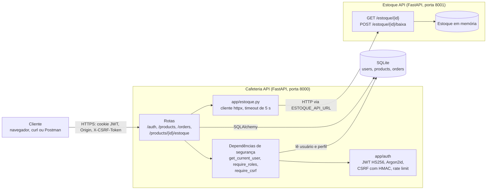
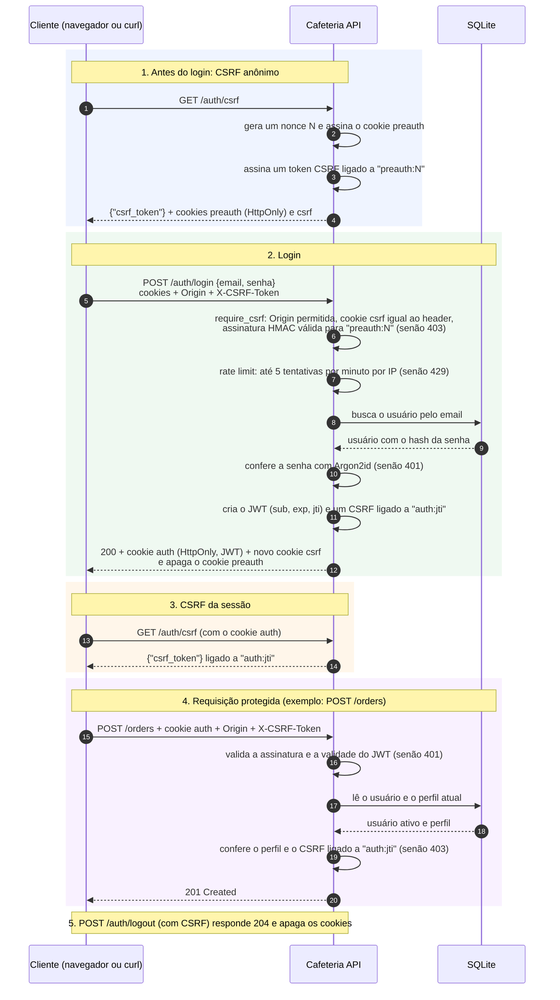
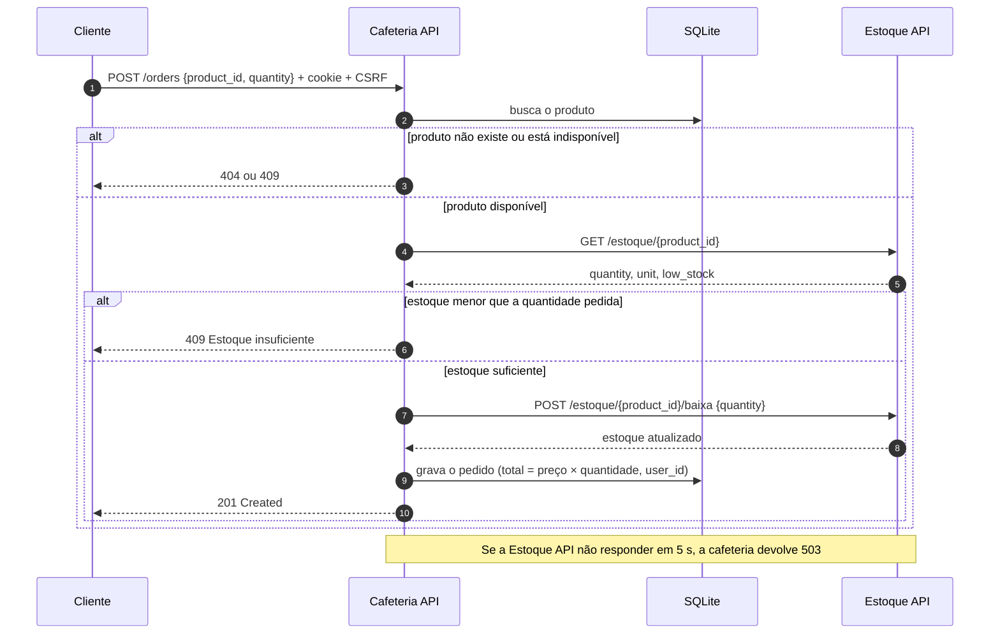

# Cafeteria API

Este documento apresenta a Cafeteria API: o que ela faz, como funciona o login, como rodar e testar o projeto e como ela conversa com a API de estoque.

**Sumário**

1. [Apresentação do sistema](#1-apresentação-do-sistema)
2. [Autenticação](#2-autenticação)
3. [Documentação de uso](#3-documentação-de-uso)
4. [Integração com API externa](#4-integração-com-api-externa)

---

## 1. Apresentação do sistema

### O que é

A **Cafeteria API** é uma API REST que gerencia o cardápio e os pedidos de uma cafeteria. Ela foi feita em Python com FastAPI e guarda os dados em SQLite.

Para usar a API, você cria uma conta e faz login. O sistema identifica quem você é e libera só o que o seu perfil pode fazer. Ao receber um pedido, a API consulta uma segunda API, a de estoque, para saber se há ingrediente suficiente.

### Casos de uso principais

- **Ver o cardápio:** qualquer pessoa, mesmo sem login, lista os produtos e vê os detalhes de cada um.
- **Criar conta e entrar:** o cliente se cadastra com nome, email e senha e depois faz login.
- **Fazer um pedido:** o cliente logado escolhe um produto e a quantidade. A API confere o estoque, desconta a quantidade e calcula o valor total.
- **Acompanhar pedidos:** o cliente vê só os pedidos dele. Funcionários e administradores veem todos.
- **Atender pedidos:** o funcionário muda o status do pedido (`pending` → `preparing` → `ready` → `delivered`).
- **Consultar o estoque de um produto:** o funcionário vê o produto junto com a quantidade em estoque e se ele pode ser vendido.
- **Gerenciar o cardápio:** o administrador cria, edita e apaga produtos e pode substituir ou apagar pedidos.

### Tipos de usuário e permissões

| Perfil | Quem é | Como é criado |
| --- | --- | --- |
| Visitante | Quem não fez login | — |
| `customer` | Cliente da cafeteria | Pelo cadastro público (`POST /auth/register`) |
| `staff` | Funcionário | Pelo comando `python -m app.create_demo_users` |
| `admin` | Administrador | Pelo comando `python -m app.create_demo_users` |

O cadastro público **sempre** cria um `customer`. Se você tentar enviar o campo `role` no cadastro, a API responde `422`.

O que cada perfil pode fazer:

| Rota | Visitante | customer | staff | admin |
| --- | --- | --- | --- | --- |
| `GET /products` e `GET /products/{id}` | sim | sim | sim | sim |
| `POST`, `PUT`, `PATCH`, `DELETE /products` | 401 | 403 | 403 | sim |
| `GET /products/{id}/estoque` | 401 | 403 | sim | sim |
| `GET /orders` | 401 | só os dele | todos | todos |
| `GET /orders/{id}` | 401 | só se for dele | sim | sim |
| `POST /orders` | 401 | sim | sim | sim |
| `PATCH /orders/{id}` | 401 | 403 | sim | sim |
| `PUT` e `DELETE /orders/{id}` | 401 | 403 | 403 | sim |

`401` significa "faça login". `403` significa "você está logado, mas seu perfil não pode fazer isso".

### Dados que o sistema gerencia

| Dado | Onde fica | Campos principais |
| --- | --- | --- |
| **Usuário** | Tabela `users` | `name`, `email` (único), `password_hash`, `role`, `is_active`, `created_at` |
| **Produto** | Tabela `products` | `name`, `description`, `category`, `price`, `size`, `is_available`, `calories` |
| **Pedido** | Tabela `orders` | `customer_name`, `table_number`, `payment_method`, `quantity`, `status`, `is_takeaway`, `product_id`, `total_amount` (calculado), `user_id` (quem criou) |
| **Estoque** | API externa de estoque | `ingredient`, `quantity`, `unit`, `minimum`, `low_stock` |

Na primeira execução, o banco recebe três produtos e três pedidos de exemplo. Os pedidos de exemplo não têm dono, então só `staff` e `admin` conseguem vê-los.

### Arquitetura

A aplicação tem duas APIs. A **Cafeteria API** recebe as suas requisições, confere login, perfil e CSRF e guarda os dados no SQLite. Quando precisa saber do estoque, ela chama a **Estoque API**, um serviço separado que guarda as quantidades em memória.



---

## 2. Autenticação

### Como funciona

A API usa um **JWT guardado em um cookie HttpOnly**, junto com uma proteção **CSRF**. Passo a passo:

1. **Você pede um token CSRF:** `GET /auth/csrf` devolve `{"csrf_token": "..."}` e grava dois cookies (`csrf` e `preauth`).
2. **Você cria a conta:** `POST /auth/register` com nome, email e senha. Toda requisição que altera dados precisa enviar o header `Origin` e o token no header `X-CSRF-Token`.
3. **Você faz login:** `POST /auth/login` com email e senha. A API compara a senha com o hash Argon2id guardado no banco.
4. **A API cria o JWT:** se a senha estiver certa, a API assina um JWT que vale 30 minutos e o entrega **somente** em um cookie HttpOnly. O token nunca aparece no corpo da resposta.
5. **Você pede um CSRF novo:** depois do login, o token antigo deixa de valer. Chame `GET /auth/csrf` de novo para receber um token ligado à nova sessão.
6. **Você usa a API:** o cookie vai junto em toda requisição. A cada chamada, a API valida a assinatura e a validade do JWT, busca o usuário no banco e confere o perfil. Nas rotas que alteram dados, ela também confere o CSRF.
7. **Você sai:** `POST /auth/logout` apaga os cookies.

O diagrama abaixo mostra o fluxo completo de login e CSRF. Nele, `preauth:N` e `auth:jti` indicam a quem o token CSRF está ligado. Antes do login, ele está ligado ao cookie `preauth`. Depois, fica ligado ao JWT da sessão. Por isso um token copiado de outra sessão não funciona.



### Por que escolhemos essa abordagem

Guardar o token de autenticação (JWT) em um cookie HttpOnly é uma das formas mais seguras de manter a sessão do usuário em aplicações web. Os principais motivos:

1. Proteção contra roubo por XSS. Um cookie marcado como HttpOnly não pode ser lido por JavaScript. Se um script malicioso for injetado na página, ele não consegue acessar o token. No localStorage ou no sessionStorage, o token ficaria exposto a qualquer script.

2. Envio automático e transparente. O navegador anexa o cookie a cada requisição para o domínio da aplicação. O front-end não precisa ler, guardar nem inserir o token manualmente no cabeçalho Authorization. Isso deixa o código mais simples e reduz a chance de erro.

3. Camadas extras de segurança. O cookie aceita atributos que reforçam a proteção:

Secure: o cookie só trafega por HTTPS.
SameSite (Strict ou Lax): reduz bastante o risco de ataques CSRF.
Expires/Max-Age, Path e Domain: controlam o tempo de vida e onde o cookie vale.

### Pontos fortes

- O token não aparece no JSON nem no `localStorage`, então não vaza para o JavaScript da página.
- O CSRF é **assinado** e **ligado à sessão**. Um token copiado de outro navegador ou de outra sessão não funciona.
- A senha é guardada com Argon2id, o algoritmo recomendado pela OWASP.
- O login responde com a mesma mensagem para email inexistente, senha errada e usuário inativo, então ninguém descobre quais emails têm conta.
- A aplicação **não sobe** com configuração insegura, por exemplo sem chave secreta forte ou sem origens permitidas.
- Desativar um usuário ou trocar o perfil dele tem efeito imediato.

### Pontos fracos e quando não usar

Pontos fracos

1. Fica exposto a CSRF. O navegador envia o cookie sozinho em toda requisição, inclusive nas que um site malicioso dispara. Sem SameSite, token anti-CSRF ou checagem de Origin, um atacante consegue fazer ações em nome do usuário.

2. Não impede XSS, só limita o estrago. O script injetado não lê o token, mas pode fazer requisições autenticadas de dentro da página enquanto o usuário estiver nela. O HttpOnly protege o token, não a sessão.

3. Revogar o token é difícil. Um JWT vale até expirar. Para derrubar a sessão na hora (troca de senha, demissão, aparelho roubado), é preciso manter uma lista de bloqueio ou fazer rotação com refresh token. Na prática, isso traz de volta o estado no servidor que o JWT queria eliminar.

4. Tamanho e limites. Cada cookie tem limite de cerca de 4 KB, e o JWT viaja em todas as requisições ao domínio, inclusive as de imagens e arquivos estáticos. Com muitas claims, o token cresce e gera tráfego desnecessário.

Quando **não** usar essa abordagem:

1 . Apps mobile nativos, desktop e integrações servidor a servidor. Nesses casos não há navegador gerenciando cookies, e o padrão é o token no cabeçalho Authorization: Bearer, guardado em armazenamento seguro (Keychain, Keystore).
2 . APIs públicas consumidas por terceiros. Clientes externos esperam chaves de API ou OAuth com Bearer token, não cookies.
3 . Quando a revogação imediata é obrigatória. Sistemas bancários, financeiros ou com dados sensíveis costumam se sair melhor com sessão tradicional no servidor (session ID opaco em cookie HttpOnly), que pode ser derrubada na hora.
4 . Aplicação web simples com um único back-end. Se não há microsserviços nem necessidade de autenticação sem estado, a sessão clássica no servidor é mais simples, menor e mais fácil de revogar. O JWT só acrescenta complexidade.
5 . Cenários com muitos domínios ou embutidos em iframe. Widgets incorporados em sites de terceiros sofrem com o bloqueio de cookies de terceiros.

### Implementação

Tecnologias usadas:

| Biblioteca | Para quê |
| --- | --- |
| [FastAPI](https://fastapi.tiangolo.com/) | Rotas e injeção de dependências (`Depends`), que aplicam login, perfil e CSRF |
| [PyJWT](https://pyjwt.readthedocs.io/) | Criar e validar o JWT (HS256) |
| [argon2-cffi](https://argon2-cffi.readthedocs.io/) | Gerar e verificar o hash das senhas com Argon2id |
| Pydantic + email-validator | Validar o corpo das requisições (email, tamanho da senha, campos proibidos) |
| SQLAlchemy + SQLite | Guardar usuários, produtos e pedidos |
| python-dotenv | Ler o arquivo `.env` |
| httpx | Chamar a API de estoque |

Estrutura do código de autenticação:

```text
app/
├── auth/
│   ├── config.py        # lê e valida as variáveis de ambiente; recusa configuração insegura
│   ├── security.py      # Argon2id, criação e validação do JWT, tokens CSRF com HMAC
│   ├── dependencies.py  # get_current_user, require_roles e require_csrf
│   ├── rate_limit.py    # limite de tentativas de login por IP
│   └── schemas.py       # formato da entrada e da saída (nunca devolve a senha)
├── routers/
│   ├── auth.py          # /auth/csrf, /auth/register, /auth/login, /auth/me, /auth/logout
│   ├── products.py      # cardápio público; alterações só para admin
│   ├── orders.py        # pedidos com regras por perfil
│   └── stock.py         # produto + estoque externo
└── create_demo_users.py # cria os usuários admin, staff e customer pelo terminal
```

As rotas são protegidas com dependências do FastAPI. Veja o trecho real de [app/routers/products.py](app/routers/products.py):

```python
# o cardapio e publico, so o admin mexe nos produtos
somente_admin = [Depends(require_roles(UserRole.ADMIN)), Depends(require_csrf)]

@router.post("", ..., dependencies=somente_admin)
def create_product(data: ProductCreate, db: Session = Depends(get_db)):
    ...
```

`require_roles` usa `get_current_user`, que lê o cookie, valida o JWT e busca o usuário no banco ([app/auth/dependencies.py](app/auth/dependencies.py)):

```python
def get_current_user(...) -> User:
    token = request.cookies.get(settings.auth_cookie)
    if not token:
        raise authentication_error()          # 401
    claims = decode_access_token(token, settings)
    user = db.get(User, int(claims["sub"]))
    if user is None or not user.is_active:
        raise authentication_error()          # 401
    return user


def require_roles(*roles: UserRole):
    def checker(user: User = Depends(get_current_user)) -> User:
        if user.role not in roles:
            raise HTTPException(status_code=403, detail="Você não tem permissão para essa ação.")
        return user
    return checker
```

A ordem das verificações é sempre: login (`401`), depois perfil (`403`) e por último CSRF (`403`).

### Segurança

**Como as senhas são protegidas**

- Elas são guardadas como hash **Argon2id** (64 MiB de memória, 3 iterações, sal aleatório). A senha original nunca é salva.
- No cadastro, a senha precisa ter de 12 a 128 caracteres e não pode ser só espaços.
- Mesmo quando o email não existe, o login roda a verificação Argon2id contra um hash falso. Assim, o tempo de resposta não revela se a conta existe.
- Se a validação falhar (`422`), a resposta **não** repete o que você enviou, então a senha não aparece em mensagens de erro.

**Rate limiting**

- Cada IP pode tentar o login no máximo **5 vezes a cada 60 segundos**. Os valores mudam por `AUTH_LOGIN_MAX_ATTEMPTS` e `AUTH_LOGIN_WINDOW_SECONDS`.
- Passou do limite, a API responde `429 Too Many Requests` com o header `Retry-After`, que diz quantos segundos esperar.
- Tentativas certas também contam, e o header `X-Forwarded-For` é ignorado para que ninguém finja outro IP.

**Expiração dos tokens**

- O JWT expira em **30 minutos** por padrão. O valor muda por `AUTH_TOKEN_TTL_MINUTES` (de 1 a 60).
- O token CSRF expira junto com o JWT.
- O JWT é assinado com HS256 e carrega `sub`, `iat`, `exp`, `jti`, `role`, `iss` e `aud`. A API recusa token adulterado, expirado ou com campos faltando.

**Outras proteções**

- Os cookies usam `HttpOnly` e `SameSite=Lax`. Em HTTPS, também usam `Secure` e o prefixo `__Host-`.
- Toda alteração exige o header `Origin` com um valor da lista `AUTH_ALLOWED_ORIGINS`.
- As rotas de autenticação só funcionam em HTTPS. HTTP só é aceito em `localhost` quando o modo de desenvolvimento está ligado.
- As respostas de `/auth/*` vêm com `Cache-Control: no-store`, para não ficarem em cache.

Quer os detalhes técnicos? Leia o documento de arquitetura em [docs/arquitetura-autenticacao.pdf](docs/arquitetura-autenticacao.pdf).

---

## 3. Documentação de uso

### O que você precisa

- Python 3.11 ou mais novo
- curl
- No Windows, Git Bash para rodar os exemplos (eles usam sintaxe Bash)

### Como rodar o projeto

**1. Instale as dependências e crie o `.env`.** Rode na pasta do projeto:

```bash
python -m venv .venv
source .venv/bin/activate          # no Git Bash do Windows: source .venv/Scripts/activate
python -m pip install -r requirements.txt
cp .env.example .env
python -c "import secrets; from dotenv import set_key; set_key('.env', 'AUTH_JWT_SECRET', secrets.token_urlsafe(48))"
```

No PowerShell, troque três comandos: `py -m venv .venv`, `.venv\Scripts\activate` e `Copy-Item .env.example .env`.

Gere a chave só na primeira vez. Nunca envie o `.env` para o GitHub.

**2. Suba as duas APIs, cada uma em um terminal** (com o ambiente virtual ativo nos dois):

```bash
# Terminal 1: API de estoque (porta 8001)
python -m uvicorn estoque_api.main:app --port 8001

# Terminal 2: Cafeteria API (porta 8000)
python -m uvicorn app.main:app --reload --env-file .env
```

**3. Crie os usuários `admin` e `staff`:**

```bash
python -m app.create_demo_users --env-file .env
```

O comando pede nome, email e senha de três usuários: `admin`, `staff` e `customer`. Para os exemplos abaixo funcionarem sem mudanças, use:

| Perfil | Email | Senha |
| --- | --- | --- |
| admin | `admin@example.com` | `senha-de-teste-123` |
| staff | `staff@example.com` | `senha-de-teste-123` |
| customer | `cliente-demo@example.com` | `senha-de-teste-123` |

Essas senhas servem só para testar no seu computador. Nunca use uma senha real em exemplos, porque ela fica salva no histórico do terminal.

**4. Abra a documentação interativa:** <http://127.0.0.1:8000/docs> (Swagger).

### Variáveis de ambiente

| Variável | Obrigatória | Padrão | O que faz |
| --- | --- | --- | --- |
| `AUTH_JWT_SECRET` | sim | — | Chave que assina o JWT e o CSRF. Precisa ter pelo menos 32 bytes aleatórios em base64url. |
| `AUTH_ALLOWED_ORIGINS` | sim | — | Origens aceitas no header `Origin`, separadas por vírgula. Exemplo: `http://127.0.0.1:8000,http://localhost:8000` |
| `AUTH_ENVIRONMENT` | não | `production` | `production` ou `development` |
| `AUTH_ALLOW_INSECURE_HTTP` | não | `false` | `true` libera HTTP em `localhost`. Só funciona com `development`. |
| `AUTH_TOKEN_TTL_MINUTES` | não | `30` | Validade do JWT, de 1 a 60 minutos |
| `AUTH_LOGIN_MAX_ATTEMPTS` | não | `5` | Tentativas de login por IP dentro da janela |
| `AUTH_LOGIN_WINDOW_SECONDS` | não | `60` | Tamanho da janela de tentativas, em segundos |
| `DATABASE_URL` | não | `sqlite:///./cafeteria.db` | Endereço do banco |
| `ESTOQUE_API_URL` | não | vazio | Endereço da API de estoque. Vazio desliga a integração. |

O `.env.example` já vem pronto para rodar no seu computador (modo `development` com HTTP local).

### Exemplos de requisições

Todos os exemplos usam Bash (Linux, macOS ou Git Bash). Rode os blocos em ordem, no mesmo terminal.

**Prepare o terminal.** Estas variáveis e a função `pegar_csrf` são usadas em todos os exemplos:

```bash
BASE=http://127.0.0.1:8000
ORIGIN=http://127.0.0.1:8000
JAR=cliente.txt   # arquivo onde o curl guarda os cookies

# Busca um token CSRF novo e atualiza os cookies
pegar_csrf() {
  curl -s -b "$JAR" -c "$JAR" -H "Origin: $ORIGIN" "$BASE/auth/csrf" \
    | python -c 'import json,sys; print(json.load(sys.stdin)["csrf_token"])'
}
```

**Ver o cardápio** (público, sem login):

```bash
curl -s "$BASE/products"
```

```text
[{"name":"Café Expresso","description":null,"category":"Bebidas","price":5.0,"size":"100ml","is_available":true,"calories":5,"id":1}, ...]
```

**Criar uma conta de cliente:**

```bash
CSRF=$(pegar_csrf)
curl -s -b "$JAR" -c "$JAR" -X POST "$BASE/auth/register" \
  -H "Origin: $ORIGIN" -H "X-CSRF-Token: $CSRF" -H "Content-Type: application/json" \
  -d '{"name":"Ana Cliente","email":"ana@example.com","password":"senha-de-teste-123"}'
```

```json
{"id":3,"name":"Ana Cliente","email":"ana@example.com","role":"customer","is_active":true,"created_at":"2026-10-29T19:05:47.730324Z"}
```

**Fazer login.** O JWT chega só no cookie, e por isso o comando usa `-c "$JAR"`. Depois do login, busque um CSRF novo:

```bash
curl -s -b "$JAR" -c "$JAR" -X POST "$BASE/auth/login" \
  -H "Origin: $ORIGIN" -H "X-CSRF-Token: $CSRF" -H "Content-Type: application/json" \
  -d '{"email":"ana@example.com","password":"senha-de-teste-123"}'

CSRF=$(pegar_csrf)   # o token antigo não vale mais
```

**Ver quem está logado:**

```bash
curl -s -b "$JAR" "$BASE/auth/me"
```

**Fazer um pedido** (2 cafés expressos):

```bash
curl -s -b "$JAR" -X POST "$BASE/orders" \
  -H "Origin: $ORIGIN" -H "X-CSRF-Token: $CSRF" -H "Content-Type: application/json" \
  -d '{"customer_name":"Ana Cliente","table_number":3,"payment_method":"Pix","quantity":2,"is_takeaway":false,"product_id":1}'
```

```json
{"customer_name":"Ana Cliente","table_number":3,"payment_method":"Pix","quantity":2,"status":"pending","is_takeaway":false,"product_id":1,"id":4,"total_amount":10.0}
```

A API calculou `total_amount` (5,00 × 2) e descontou 2 doses na API de estoque.

**Ver os meus pedidos:**

```bash
curl -s -b "$JAR" "$BASE/orders"
```

O cliente recebe só o pedido `4`, que é dele. Os pedidos 1 a 3 não aparecem.

**Entrar como funcionário (staff).** Para não repetir os passos de login, crie a função `entrar`:

```bash
# Faz login com o email e a senha informados e já busca o CSRF novo
entrar() {
  CSRF=$(pegar_csrf)
  curl -s -b "$JAR" -c "$JAR" -X POST "$BASE/auth/login" \
    -H "Origin: $ORIGIN" -H "X-CSRF-Token: $CSRF" -H "Content-Type: application/json" \
    -d "{\"email\":\"$1\",\"password\":\"$2\"}"
  CSRF=$(pegar_csrf)
}

JAR=staff.txt
entrar staff@example.com senha-de-teste-123
```

**Mudar o status de um pedido** (staff ou admin):

```bash
curl -s -b "$JAR" -X PATCH "$BASE/orders/4" \
  -H "Origin: $ORIGIN" -H "X-CSRF-Token: $CSRF" -H "Content-Type: application/json" \
  -d '{"status":"preparing"}'
```

**Ver o produto junto com o estoque** (staff ou admin):

```bash
curl -s -b "$JAR" "$BASE/products/1/estoque"
```

```json
{"id":1,"name":"Café Expresso","category":"Bebidas","price":5.0,"is_available":true,"stock":{"ingredient":"Grãos de café","quantity":38,"unit":"doses","low_stock":false},"can_sell":true}
```

**Criar um produto** (somente admin):

```bash
JAR=admin.txt
entrar admin@example.com senha-de-teste-123

curl -s -b "$JAR" -X POST "$BASE/products" \
  -H "Origin: $ORIGIN" -H "X-CSRF-Token: $CSRF" -H "Content-Type: application/json" \
  -d '{"name":"Cappuccino","category":"Bebidas","price":9.5,"size":"250ml","is_available":true,"calories":120}'
```

**Sair:**

```bash
curl -s -i -b "$JAR" -c "$JAR" -X POST "$BASE/auth/logout" \
  -H "Origin: $ORIGIN" -H "X-CSRF-Token: $CSRF"      # HTTP/1.1 204 No Content

curl -s -b "$JAR" "$BASE/auth/me"                    # agora responde 401
```

Os arquivos de cookies (`cliente.txt`, `staff.txt` e `admin.txt`) guardam a sua sessão. Apague-os quando terminar.

### Como autenticar em cada endpoint protegido

A regra geral é simples:

- **Rotas `GET`** precisam só do **cookie de login** (`-b "$JAR"`).
- **Rotas que alteram dados** (`POST`, `PUT`, `PATCH`, `DELETE`) precisam do **cookie de login**, do header **`Origin`** e do header **`X-CSRF-Token`** com o token de `GET /auth/csrf`.

| Endpoint | O que enviar | Perfil |
| --- | --- | --- |
| `GET /auth/me` | cookie | qualquer usuário logado |
| `POST /auth/register` e `POST /auth/login` | cookies do `/auth/csrf` + `Origin` + `X-CSRF-Token` | visitante |
| `POST /auth/logout` | cookie + `Origin` + `X-CSRF-Token` | qualquer um (só apaga os cookies) |
| `GET /orders` e `GET /orders/{id}` | cookie | customer (só os dele), staff, admin |
| `POST /orders` | cookie + `Origin` + `X-CSRF-Token` | customer, staff, admin |
| `PATCH /orders/{id}` | cookie + `Origin` + `X-CSRF-Token` | staff, admin |
| `PUT` e `DELETE /orders/{id}` | cookie + `Origin` + `X-CSRF-Token` | admin |
| `POST`, `PUT`, `PATCH`, `DELETE /products` | cookie + `Origin` + `X-CSRF-Token` | admin |
| `GET /products/{id}/estoque` | cookie | staff, admin |

Lembre-se: busque um token CSRF **novo depois do login**. O token de antes do login para de funcionar.

**No Postman:**

1. Deixe o gerenciamento de cookies ligado (ele vem ligado por padrão).
2. Faça `GET {{base}}/auth/csrf` e copie o valor de `csrf_token`.
3. Nas requisições `POST`, `PUT`, `PATCH` e `DELETE`, adicione os headers `X-CSRF-Token: <token>` e `Origin: http://127.0.0.1:8000`.
4. Depois do login, repita o passo 2 e troque o token.
5. Não configure "Bearer Token" na aba Authorization. A API não usa esse header.

### Exemplos de erro

Estas respostas foram tiradas da API rodando, usando os mesmos arquivos de cookies dos exemplos acima.

**401 Unauthorized: sem login**

```bash
curl -s -i "$BASE/orders"
```

```text
HTTP/1.1 401 Unauthorized
{"detail":"Autenticação ausente, inválida ou expirada."}
```

**401 Unauthorized: email ou senha errados**

```text
HTTP/1.1 401 Unauthorized
{"detail":"Email ou senha inválidos."}
```

**403 Forbidden: perfil sem permissão** (cliente tentando apagar um produto)

```bash
JAR=cliente.txt
CSRF=$(pegar_csrf)   # volta para a sessão da cliente Ana
curl -s -i -b "$JAR" -X DELETE "$BASE/products/1" \
  -H "Origin: $ORIGIN" -H "X-CSRF-Token: $CSRF"
```

```text
HTTP/1.1 403 Forbidden
{"detail":"Você não tem permissão para essa ação."}
```

**403 Forbidden: CSRF ausente** (pedido enviado sem o header `X-CSRF-Token`)

```bash
curl -s -i -b "$JAR" -X POST "$BASE/orders" \
  -H "Origin: $ORIGIN" -H "Content-Type: application/json" \
  -d '{"customer_name":"Ana Cliente","table_number":3,"payment_method":"Pix","quantity":1,"is_takeaway":false,"product_id":1}'
```

```text
HTTP/1.1 403 Forbidden
{"detail":"Proteção CSRF inválida ou ausente."}
```

**403 Forbidden: pedido de outra pessoa**

```bash
curl -s -i -b "$JAR" "$BASE/orders/1"
```

```text
HTTP/1.1 403 Forbidden
{"detail":"Você só pode ver os seus próprios pedidos."}
```

**429 Too Many Requests: muitas tentativas de login**

```text
HTTP/1.1 429 Too Many Requests
retry-after: 26
{"detail":"Muitas tentativas de login. Tente novamente mais tarde."}
```

Resumo dos códigos de erro:

| Código | Quando acontece |
| --- | --- |
| `401` | Sem cookie, token inválido ou expirado, usuário inativo ou email e senha errados |
| `403` | Perfil sem permissão, CSRF ausente ou inválido, `Origin` não permitida ou pedido de outro cliente |
| `404` | Produto ou pedido não existe |
| `409` | Email já cadastrado, produto indisponível, estoque insuficiente ou produto com pedidos ao tentar apagar |
| `422` | Corpo da requisição inválido (campo faltando, senha curta, campo proibido como `role`) |
| `429` | Limite de tentativas de login excedido |
| `503` | API de estoque fora do ar ou não configurada |

### Versão publicada (deploy)

<!-- Preencher após o deploy: substituir <URL_DO_DEPLOY> e <URL_DO_ESTOQUE> pelos endereços reais. -->

- **Cafeteria API:** `<URL_DO_DEPLOY>`
- **Documentação interativa:** `<URL_DO_DEPLOY>/docs`
- **API de estoque:** `<URL_DO_ESTOQUE>`

**Como testar online**

1. Abra `<URL_DO_DEPLOY>/docs` para ver todos os endpoints. Os endpoints públicos, como `GET /products`, já funcionam por lá.
2. Para testar o login e as rotas protegidas, use o mesmo roteiro de curl acima e troque só as duas primeiras variáveis:

   ```bash
   BASE=<URL_DO_DEPLOY>
   ORIGIN=<URL_DO_DEPLOY>
   ```

3. Online, a API roda em HTTPS. Os cookies passam a se chamar `__Host-cafeteria_auth`, `__Host-cafeteria_csrf` e `__Host-cafeteria_preauth`. O arquivo de cookies do curl cuida disso sozinho.

Configuração necessária no servidor publicado:

```env
AUTH_ENVIRONMENT=production
AUTH_ALLOW_INSECURE_HTTP=false
AUTH_ALLOWED_ORIGINS=<URL_DO_DEPLOY>
AUTH_JWT_SECRET=<chave gerada com secrets.token_urlsafe(48)>
ESTOQUE_API_URL=<URL_DO_ESTOQUE>
```

### Rodar os testes automatizados

```bash
python -m pip install -r requirements-dev.txt
python -m pytest -v
```

Os testes usam bancos temporários e chaves de teste. Você não precisa de um `.env` para rodá-los.

---

## 4. Integração com API externa

### Como a API se integra com o sistema externo

O estoque fica em uma API separada, a **Estoque API** ([estoque_api/main.py](estoque_api/main.py)). Ela roda em outro processo (porta 8001) e guarda os dados em memória. O id de cada item de estoque é o mesmo id do produto na cafeteria.

A Cafeteria API chama a Estoque API pelo módulo [app/estoque.py](app/estoque.py), usando `httpx` com timeout de 5 segundos. O endereço vem da variável `ESTOQUE_API_URL`. Se ela estiver vazia, a integração fica desligada: os pedidos são criados sem consultar o estoque, e `GET /products/{id}/estoque` responde `503`. O diagrama de [arquitetura](#arquitetura) mostra onde cada parte fica.

Os erros da Estoque API são traduzidos para quem chamou a Cafeteria API:

| O que aconteceu na Estoque API | O que a Cafeteria API responde |
| --- | --- |
| Não respondeu (fora do ar ou timeout) | `503` "Não foi possível falar com a API de estoque." |
| `404`: produto sem estoque cadastrado | `404` "Produto não encontrado no estoque." |
| `409`: estoque insuficiente na baixa | `409` "Estoque insuficiente para esse pedido." |
| Qualquer outro erro | `502` "A API de estoque respondeu com erro." |

### Quais dados são consultados

A Cafeteria API usa dois endpoints da Estoque API:

| Endpoint da Estoque API | Para quê |
| --- | --- |
| `GET /estoque/{product_id}` | Saber quanto há em estoque |
| `POST /estoque/{product_id}/baixa` com `{"quantity": 2}` | Descontar a quantidade de um pedido |

Resposta de `GET /estoque/1`:

```json
{"product_id":1,"ingredient":"Grãos de café","quantity":38,"unit":"doses","minimum":10,"low_stock":false,"checked_at":"2026-10-29T16:06:14"}
```

`low_stock` fica `true` quando a quantidade chega ao mínimo (`quantity <= minimum`).

### Como os dados são combinados

**Em `GET /products/{id}/estoque`** (staff e admin), a API junta duas fontes em uma resposta só:

1. Busca o produto no banco local: `id`, `name`, `category`, `price` e `is_available`.
2. Busca o estoque na Estoque API: `ingredient`, `quantity`, `unit` e `low_stock`.
3. Calcula `can_sell`, que só é `true` quando o produto está ativo no cardápio **e** o estoque é maior que zero.

Dois exemplos reais com os dados iniciais:

```json
{"id":1,"name":"Café Expresso","category":"Bebidas","price":5.0,"is_available":true,
 "stock":{"ingredient":"Grãos de café","quantity":38,"unit":"doses","low_stock":false},
 "can_sell":true}
```

```json
{"id":3,"name":"Fatia de Bolo de Chocolate","category":"Doces","price":12.0,"is_available":false,
 "stock":{"ingredient":"Massa de bolo de chocolate","quantity":0,"unit":"fatias","low_stock":true},
 "can_sell":false}
```

**Em `POST /orders`**, o estoque decide se o pedido pode ser criado:

1. A API confere no banco local se o produto existe e está disponível. Se não estiver, responde `404` ou `409`.
2. Consulta o estoque (`GET /estoque/{id}`).
3. Se a quantidade em estoque for menor que a pedida, responde `409`, por exemplo `"Estoque insuficiente de 'Pão de Queijo'."`
4. Desconta a quantidade (`POST /estoque/{id}/baixa`).
5. Salva o pedido no banco local, com `total_amount = preço do produto × quantidade` e o `user_id` de quem pediu.



### Limitações da integração

- O estoque fica em memória: quando a Estoque API reinicia, as quantidades voltam ao valor inicial.
- Só os produtos 1, 2 e 3 têm estoque. Um produto novo criado pelo admin não tem estoque, então a consulta e os pedidos desse produto respondem `404` até que ele seja cadastrado na Estoque API.
- A baixa acontece antes de o pedido ser salvo. Se a gravação do pedido falhar, o estoque já foi descontado.
- Editar, substituir ou apagar um pedido não devolve nem ajusta o estoque.
